# Mermaid Diagrams — Full Project Documentation

Below is a set of Mermaid diagrams covering the entire project, from macro architecture down to micro-level details. Each is styled with a white background for readability.

---

## Diagram 1 — Master Overview (Macro)

The full system, from scenario YAML to consumed output.

```mermaid
%%{init: {'theme': 'base', 'themeVariables': { 'background': '#ffffff', 'primaryColor': '#e0f2fe', 'primaryTextColor': '#0f172a', 'primaryBorderColor': '#0284c7', 'lineColor': '#475569', 'secondaryColor': '#f1f5f9', 'tertiaryColor': '#fef3c7', 'fontFamily': 'Segoe UI, Arial' }}}%%
flowchart TB
    subgraph CONFIG["Declarative Config (YAML)"]
        direction LR
        S["signals.yaml<br/>9 signals"]
        SY["systems.yaml<br/>subsystems"]
        R["relationships.yaml<br/>cross-signal physics"]
        V["vehicles.yaml<br/>2 vehicle profiles"]
        M["messages.yaml<br/>CAN message sets"]
        F["faults/*.yaml<br/>3 fault types"]
        SC["scenarios/*.yaml<br/>5 scenarios"]
        EV["evolutions/*.yaml<br/>3 timelines"]
    end

    subgraph STAGE1["Stage 1 — Clean Data Generation"]
        SG["SignalGenerator<br/>physics engine"]
        ENC["CANEncoder<br/>signal → bytes"]
        SCH["FrameScheduler<br/>asynchronous frames"]
    end

    subgraph STAGE2["Stage 2 — Fault Injection"]
        FI["SignalFaultInjector<br/>physics + post-physics"]
        FL["FaultLabelBuilder<br/>per-frame labels"]
    end

    subgraph ORCH["Orchestration"]
        P["Pipeline<br/>single scenario"]
        DB["DatasetBuilder<br/>batch scenarios"]
        EB["EvolutionBuilder<br/>multi-day timelines"]
    end

    subgraph OUTPUT["Output Files"]
        O1[".frames.csv<br/>raw CAN wire"]
        O2[".signals.csv<br/>semantic values"]
        O3[".faults.csv<br/>event summary"]
        O4[".labels.csv<br/>per-frame labels"]
        O5["manifest.csv + metadata.json"]
        O6["evolution/*<br/>timeline + metadata"]
    end

    subgraph CONSUMERS["Downstream Consumers"]
        ML["Stage 4 — ML<br/>detection & diagnosis"]
        PAPER["Stage 2 — Paper<br/>benchmark & results"]
        REAL["Stage 5 — Real vehicle<br/>validation"]
    end

    CONFIG --> ORCH
    ORCH --> STAGE1
    STAGE1 --> STAGE2
    STAGE2 --> OUTPUT
    OUTPUT --> CONSUMERS

    style CONFIG fill:#e0f2fe,stroke:#0284c7,color:#0f172a
    style STAGE1 fill:#dcfce7,stroke:#16a34a,color:#0f172a
    style STAGE2 fill:#fee2e2,stroke:#dc2626,color:#0f172a
    style ORCH fill:#fef3c7,stroke:#d97706,color:#0f172a
    style OUTPUT fill:#e9d5ff,stroke:#9333ea,color:#0f172a
    style CONSUMERS fill:#f1f5f9,stroke:#475569,color:#0f172a
```

---

## Diagram 2 — Physical Cascade (Micro)

How a single fault propagates through the physics engine.

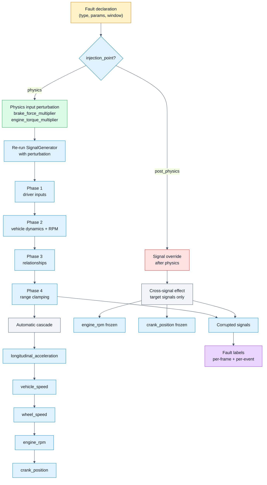

---

## Diagram 3 — Three Fault Types, Side by Side

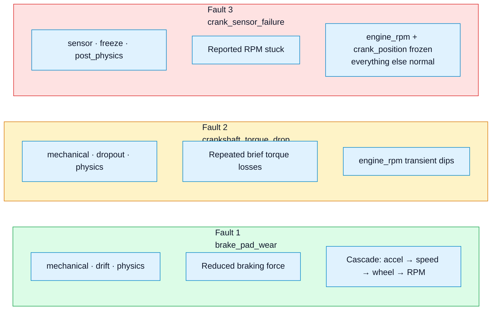

---

## Diagram 4 — Signal Flow Inside SignalGenerator (Micro)

How the physics engine computes each signal.

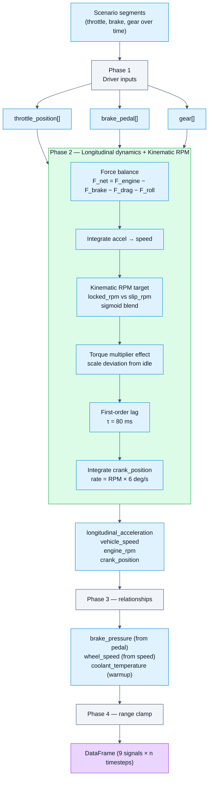

---

## Diagram 5 — Config Layer (Entity Relationships)

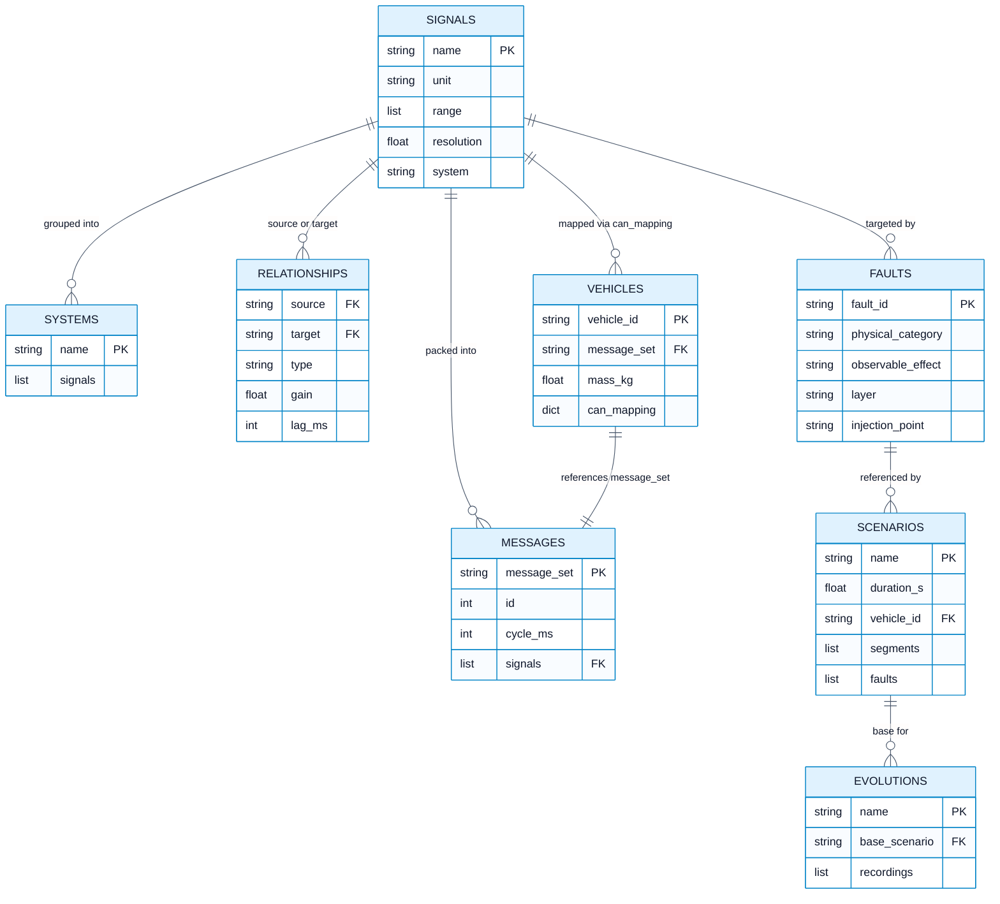

---

## Diagram 6 — Fault Injection Sequence (Micro)

Time-ordered sequence of one fault-bearing pipeline run.

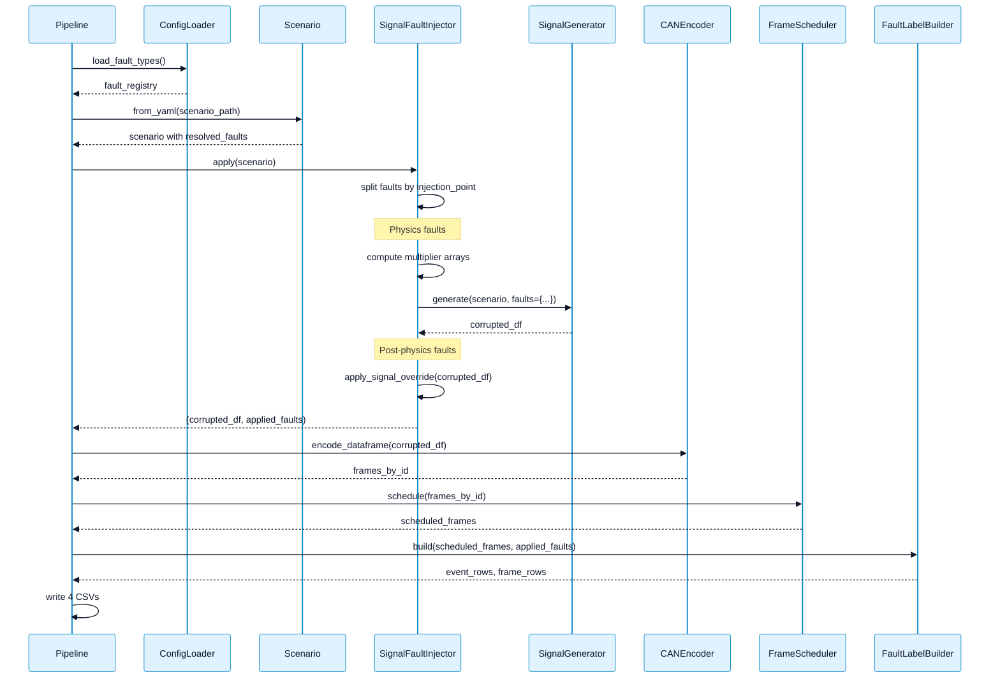

---

## Diagram 7 — Stage 2 Module Map (Macro)

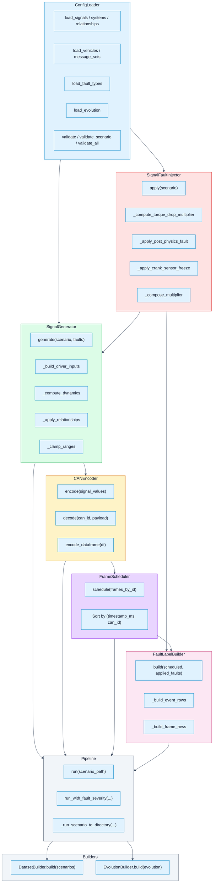

---

## Diagram 8 — Evolution Timeline Composition (Macro)

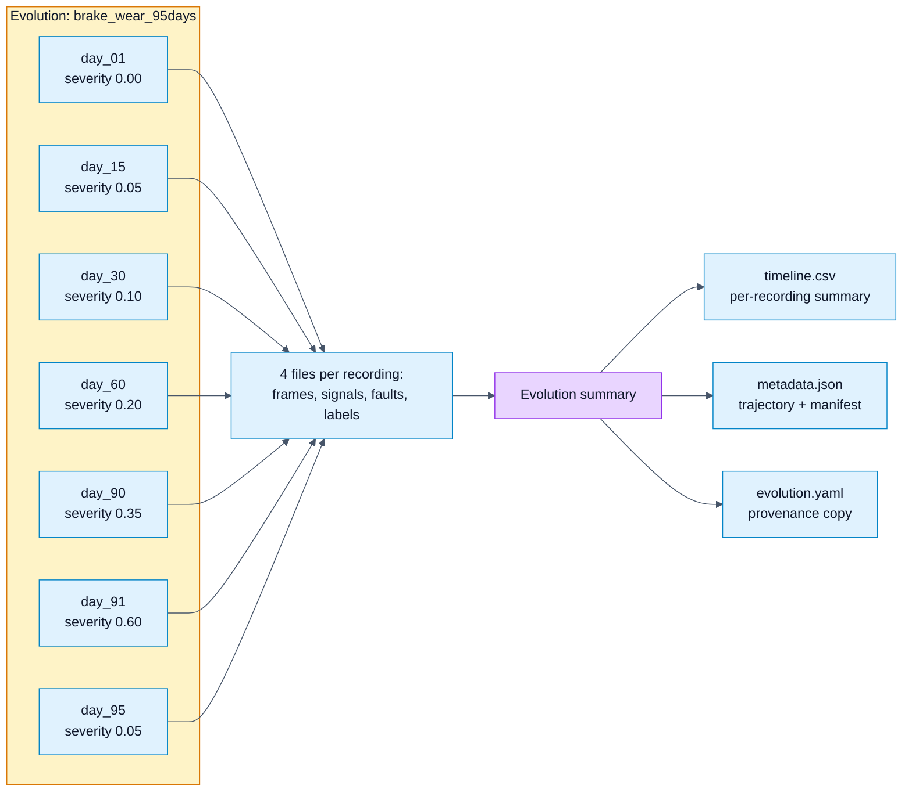

---

## Diagram 9 — Data Pipeline: From Scenario to ML Training

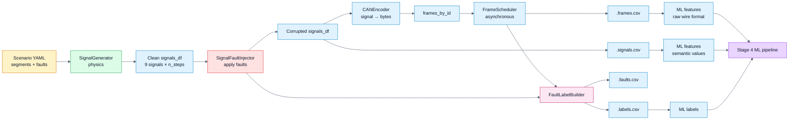

---

## Diagram 10 — Fault Lifecycle (Micro)

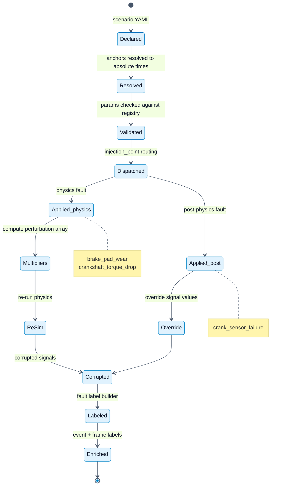

---

## Diagram 11 — MACRO View: The Five Stages of the Project

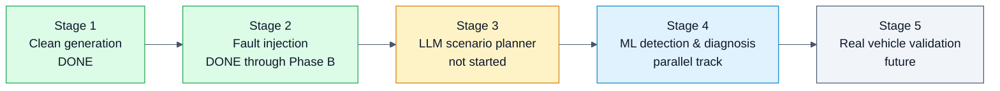

---

## Diagram 12 — Key Architectural Decisions (Macro)

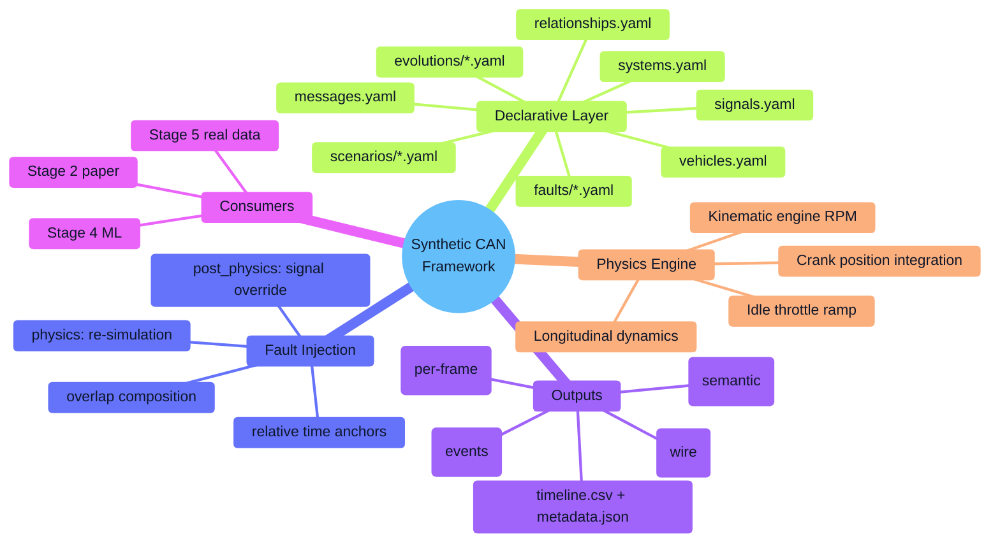

---

## Diagram 13 — Testing Hierarchy (Micro)

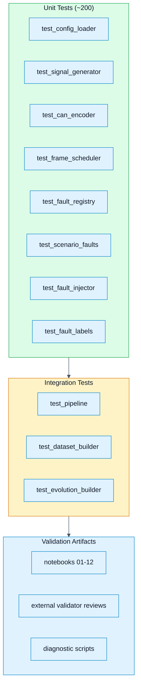

---

## Diagram 14 — Data Volume Summary (Macro)

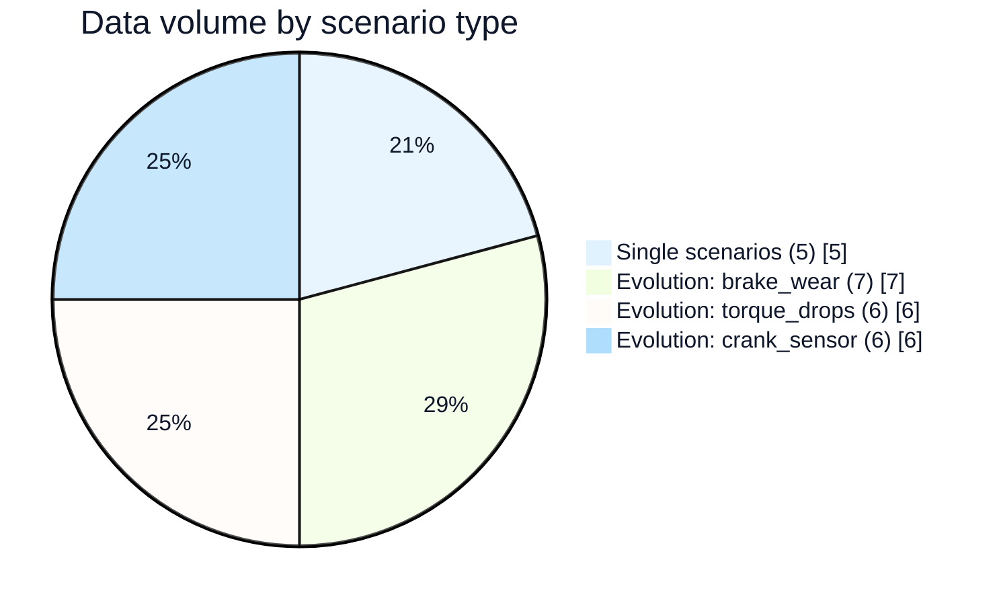

---

## Diagram 15 — Canonical Time-Series: One Fault, One Window (Micro)

```mermaid
%%{init: {'theme': 'base', 'themeVariables': { 'background': '#ffffff', 'primaryColor': '#e0f2fe', 'primaryTextColor': '#0f172a', 'primaryBorderColor': '#0284c7', 'lineColor': '#475569', 'fontFamily': 'Segoe UI, Arial' }}}%%
gantt
    title Crank sensor freeze: fault window [38, 65] with freeze [38, 58]
    dateFormat X
    axisFormat %s
    
    section Vehicle state
    Launch & cruise clean    :a1, 0, 38
    Cruise (engine still running normally) :a2, 38, 58
    Cruise (sensor recovered) :a3, 58, 65
    Exit braking              :a4, 65, 90

    section engine_rpm (reported)
    Normal                   :b1, 0, 38
    FROZEN                   :crit, b2, 38, 58
    Normal                   :b3, 58, 90

    section crank_position (reported)
    Normal                   :c1, 0, 38
    FROZEN                   :crit, c2, 38, 58
    Normal                   :c3, 58, 90

    section vehicle_speed
    Normal throughout        :d1, 0, 90
```

---

## How to Use These Diagrams

**For the presentation:**

1. **Start with Diagram 1** (Master Overview) to give the big picture
2. **Show Diagram 11** (Five Stages) to position where the project is
3. **Use Diagram 3** (Three Fault Types) to introduce the fault library
4. **Show Diagram 6** (Sequence) or **Diagram 7** (Module Map) for architecture
5. **Show Diagram 15** (Gantt) as a concrete example of a sensor freeze
6. **Close with Diagram 12** (mind map) as a summary

**For the paper's method section:**

- Diagram 1 (Master Overview) — Figure 1
- Diagram 4 (Signal Flow) — Figure 2
- Diagram 6 (Sequence) — Figure 3
- Diagram 13 (Testing Hierarchy) — Figure 4 (appendix)

**For the ML LLM:**

- Diagram 2 (Fault Cascade) — explains how physics faults propagate
- Diagram 3 (Three Fault Types) — enumerates what's available
- Diagram 9 (Data Pipeline) — shows what inputs are available at each stage

---

## Rendering Notes

All diagrams use:
- **White background** (`background: '#ffffff'`)
- **Light palette** with semantic colors (green=complete, yellow=in progress, red=fault, blue=infrastructure, purple=output)
- **Mermaid `base` theme** for consistency

To render:
- **GitHub/GitLab:** paste into a `.md` file — rendered automatically
- **Mermaid Live Editor:** https://mermaid.live — paste and export SVG/PNG
- **VS Code:** Mermaid Preview extension
- **Documentation sites:** MkDocs, Docusaurus with Mermaid plugin

If you want a **single-page PDF** combining all diagrams with section headers, I can also produce a Markdown file that's ready for `pandoc` to convert. Just say the word.